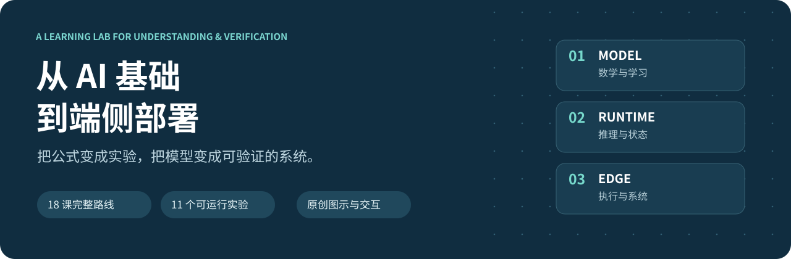
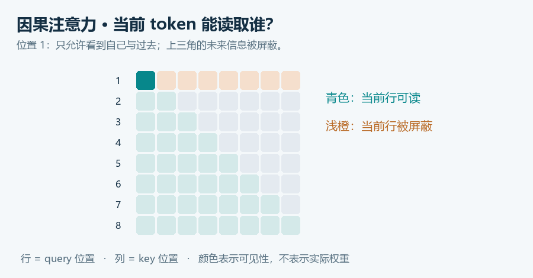
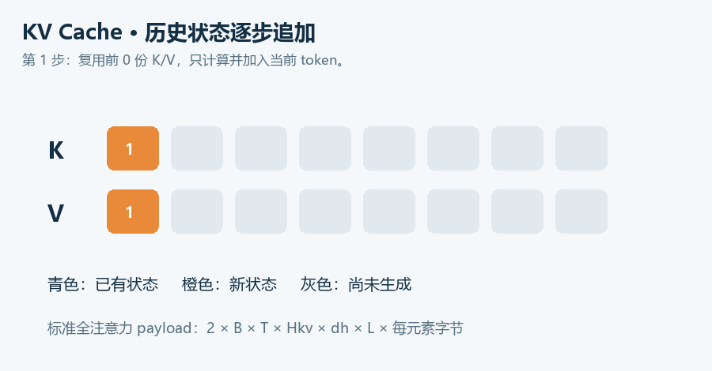
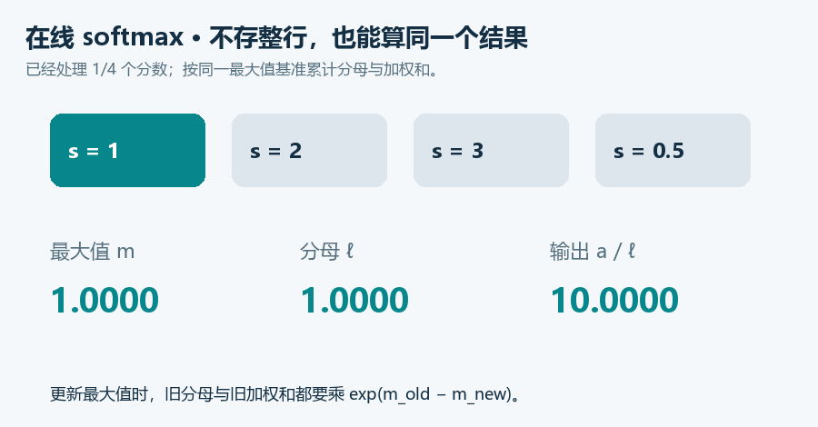

<div align="center">



**从 AI 基础到端侧部署：能解释、能运行、能核查的中文学习项目**

[开始学习](docs/roadmap.md) · [知识体系](docs/knowledge-map.md) · [课程与源码](tutorial.md) · [交互实验台](index.html) · [实验状态](reports/README.md)

</div>

把一个 AI 模型从数学公式，走到可运行、可验证的推理系统。覆盖机器学习、深度学习、PyTorch、Transformer、LLM 推理与量化、RAG/Agent、llama.cpp、vLLM/MLC、编译器、FlashAttention，以及 Rockchip NPU 部署。

**18 课完整讲解 · 11 个可运行实验 · 4 幅原创动图 · 7 幅 SVG · 交互实验页面 · 逐项可核查资料**

## 为什么这样学

学框架之前，先弄清模型在做什么；测速度之前，先证明输出正确；接硬件之前，先把输入契约和版本锁定。每课按“问题 → 直觉 → 公式/数据流 → 源码 → 实验 → 过关任务”组织。数学例子和错误反例帮助建立自己的判断，而不是背术语清单。

课程围绕完整 CPU 模型交付主线展开，并提供独立量化课程、数值等价验证、混合架构账本和实验状态说明。[本教程的理解与取舍](docs/understanding-and-decisions.md) · [版本更新说明](docs/release-notes.md)

## 学习路线


| 阶段 | 课程 | 交付结果 |
|---|---|---|
| 基础与模型交付 | [00 环境](docs/00-foundations.md) · [01 ML](docs/01-machine-learning.md) · [02 NN](docs/02-neural-networks.md) · [03 导出](docs/03-export-and-correctness.md) | 分类器、权重、ONNX、数值对照 |
| 语言模型机制 | [04 Transformer](docs/04-transformer.md) · [05 推理与缓存](docs/05-inference-and-cache.md) · [06 量化](docs/06-quantization.md) | 微型 LM、缓存校验、误差实验 |
| 应用与 Runtime | [07 RAG/Agent](docs/07-rag-and-agent.md) · [08 llama.cpp](docs/08-llama-cpp.md) · [09 Serving](docs/09-serving-and-runtimes.md) | 检索与工具基线、调度时间线、本地 LLM 练习 |
| 计算与硬件 | [10 Compiler](docs/10-compiler.md) · [11 Kernel](docs/11-kernel-and-flashattention.md) · [12 RKNN](docs/12-rknn.md) · [13 RKLLM](docs/13-rkllm.md) | 分块对照、在线 softmax、转换适配与板端验收计划 |
| 系统与综合 | [14 集成](docs/14-linux-and-integration.md) · [15 基准](docs/15-benchmark-and-debug.md) · [16 项目](docs/16-capstone.md) · [17 架构解剖](docs/17-model-anatomy.md) | 本地 HTTP 服务、原始基准、可复现项目报告 |

RAG/Agent 是应用支线，不是学习编译器的前置条件；没有板卡也能完成全部基础实验。建议每周 6–8 小时，按 [12 周主线 / 24 周从零方案](docs/roadmap.md) 自行调整，以过关任务而非日历决定是否前进。

## 五分钟跑通基础实验

Python 3.10+；在本仓库根目录执行：

```powershell
python -m venv .venv
.\.venv\Scripts\Activate.ps1
python -m pip install -r requirements.txt
python -m edge_ai_labs --lab all --seed 42
```

Linux/macOS 用 `source .venv/bin/activate` 激活。这里的“五分钟”指依赖已具备后的基础实验体验，网络安装与 PyTorch 下载另计。报告生成于 `artifacts/report-all.json`。

完整训练、导出和测试：

```powershell
python -m pip install -r requirements-export.txt
python -m edge_ai_labs --lab full --seed 42
python -m unittest discover -s tests -v
python scripts/benchmark.py
python scripts/check_docs.py
```

完整流程在 Windows CPU、Python 3.10.20、NumPy 2.2.6、PyTorch 2.11.0 下运行过；依赖详情和原始结果见 [本次验证记录](reports/README.md)。固定种子不能保证跨平台逐位一致，应使用合理容差。安装问题先看 [00 环境课](docs/00-foundations.md)。

## 动画与交互理解

| 因果注意力：当前位置能看见谁 | KV Cache：历史状态如何增长 |
|---|---|
|  |  |

| 连续批处理：完成一个就补入一个 | 在线 softmax：分块后怎样保持归一化 |
|---|---|
|  |  |

克隆后用浏览器打开 [index.html](index.html)，可拖动 KV 长度/头数和量化位宽，逐步查看注意力与调度。GitHub README 能显示 SVG/GIF，但不执行页面 JavaScript；交互请本地打开，或手动启用 GitHub Pages。图全部由本仓库脚本生成；论文图不直接打包，提供原文和推荐图号。[图示与论文阅读指南](docs/visual-guide.md)

## 当前实现到哪一步

- **已运行**：8 个 NumPy/系统实验、MLP 训练、现代 ONNX 导出、微型 LM 训练及缓存对照、HTTP 集成测试、CPU 微基准。
- **数学参考**：在线 attention、分块矩阵乘、调度 tick 模拟；没有伪装成 GPU 性能复现。
- **扩展手册/模板**：llama.cpp、vLLM、MLC、TVM、RKNN、RKLLM 与多模态板端流程；未完成对应外部 Runtime/GPU/NPU 实测。
- **明确边界**：检索实验没有调用 LLM；工具路由不等于自主 Agent；玩具语料损失下降不代表通用语言能力。

## 仓库结构

```text
docs/             课程、路线、知识体系、公式与来源
edge_ai_labs/     独立编写的数值与系统实验
adapters/         静态 ONNX 导出与 RKNN 转换模板
assets/           原创 SVG/GIF
scripts/          绘图、基准、文档校验与页面生成
tests/            数值约束与真实 HTTP 集成测试
reports/          本次验证记录与原始测量
templates/        版本矩阵和实验报告
references/       可核查文献、BibTeX 与来源保留
licenses/         第三方许可声明
index.html        无需服务端的交互实验台
tutorial.md       按输入到输出组织的源码课程入口
practice.md       配套理解与扩展题
```

贡献前请读 [CONTRIBUTING](CONTRIBUTING.md)。代码与原创文档按 [MIT](LICENSE) 发布；第三方组件遵循各自许可，声明集中保留在 `licenses/` 和 `vendor/`。论文、软件与模型遵循各自许可。
