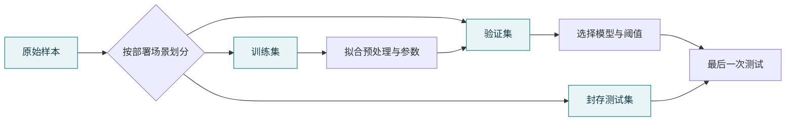

# 01 · 机器学习：先证明模型学到了可迁移的规律

> 状态：已展开。目标：从零训练一个分类器，解释损失、数据泄漏和评估。前置：第 00 课的矩阵与概率基础。

## 本课结论

机器学习不是“把数据丢进模型”。你先定义预测问题，再决定哪些信息在预测时确实可用，最后用模型没见过的数据检查它。一个简单但评估可靠的模型，比高准确率但偷看答案的模型更有价值。

本项目生成 900 条四维合成样本，按 540/180/180 切成训练、验证和测试集。合成标签来自有噪声的线性规则。这里的准确率说明代码与这份数据相匹配，不代表解决了真实业务。

## 从线性打分到概率

令 $z_i=w^\top x_i+b$，用 sigmoid 得到正类概率：

$$p_i=\sigma(z_i)=\frac{1}{1+e^{-z_i}}.$$

若标签 $y_i\in\{0,1\}$，单样本似然是 $p_i^{y_i}(1-p_i)^{1-y_i}$。对所有样本的似然取负对数并求平均：

$$\mathcal L=-\frac1n\sum_i[y_i\log p_i+(1-y_i)\log(1-p_i)].$$

这就是二元交叉熵。大白话：真答案是“是”，模型却只愿意给 0.01 的概率，就要受到更大惩罚。不要先做 0/1 判决再算损失，否则梯度信息被截断。代码使用等价但数值稳定的 `logaddexp(0,z)-y*z`。

沿 sigmoid 和对数的导数化简，有：

$$\frac{\partial\mathcal L}{\partial w}=\frac1nX^\top(p-y),\qquad
\frac{\partial\mathcal L}{\partial b}=\frac1n\sum_i(p_i-y_i).$$

梯度下降更新 $w\leftarrow w-\eta\nabla_w\mathcal L$。当一个正类样本被低估时，$p-y<0$，更新会使该样本的分数有增大的趋势。这个符号检查能帮助发现推导错误。

## 划分必须先于拟合预处理

标准化 $x'=(x-\mu)/\sigma$ 中的均值和标准差只在训练集拟合，然后原样用于验证、测试和服务。如果先用全部样本计算统计量，测试集就参与了训练流程。时序数据还应按时间切分；同一人的多个片段应按人分组；随机切分不是普适规则。



## 哪个指标在回答你的问题

$$\text{Precision}=\frac{TP}{TP+FP},\quad
\text{Recall}=\frac{TP}{TP+FN},\quad
F_1=\frac{2TP}{2TP+FP+FN}.$$

若故障样本只占 1%，永远预测正常也有 99% 准确率。漏报成本高时关注 recall；误报成本高时关注 precision；阈值必须在验证集选择。F1 不包含真负类，不能单独说明全部错误结构。概率需要用于决策时，还应检查校准。

## 不同算法怎么放在知识体系里

| 算法 | 核心直觉 | 端侧代价与适用边界 |
|---|---|---|
| 线性/逻辑回归 | 学一条打分规则 | 小、快、可解释；需合适特征 |
| KNN | 找相似的旧样本 | 训练轻，存储与检索可能重 |
| 决策树/随机森林 | 按条件逐步分流 | 表格数据常用；大森林也会占内存 |
| SVM | 寻找有间隔的分界面 | 核方法预测成本依赖支持向量数 |
| K-Means | 反复分配到最近中心再更新中心 | 聚类编号没有天然语义，不等于分类标签 |
| 强化学习 | 从状态、动作、奖励中学习决策 | 要定义环境与反馈；不是有“奖励函数”就必须用 RL |

更完整的推导可从 [Dive into Deep Learning 官方教材](https://d2l.ai/) 继续阅读；本仓库先聚焦可复现分类主链。

## 实验、源码与验收

```powershell
python -m edge_ai_labs --lab ml --seed 42
```

阅读 `math_labs.py::ml`：生成样本 → 切分 → 拟合标准化 → 梯度更新 → 按验证损失保存参数 → 最后测试。默认种子下训练损失应下降，测试准确率约 0.97；不要把精确的小数作为跨版本断言。理解来源比背结果更重要。

思考：若把测试集换成噪声更大的数据，准确率下降是在说明实现错误，还是分布变化？若在测试集上不断调阈值，下一轮应该如何重新建立独立评估？本课到参数学习结束，神经网络反向传播由第 02 课展开。

<!-- COURSE-NAV -->

---

[路线总览](roadmap.md) · [课程与源码](../tutorial.md) · [配套练习](../practice.md) · [上一课 00](00-foundations.md) · [下一课 02](02-neural-networks.md)
