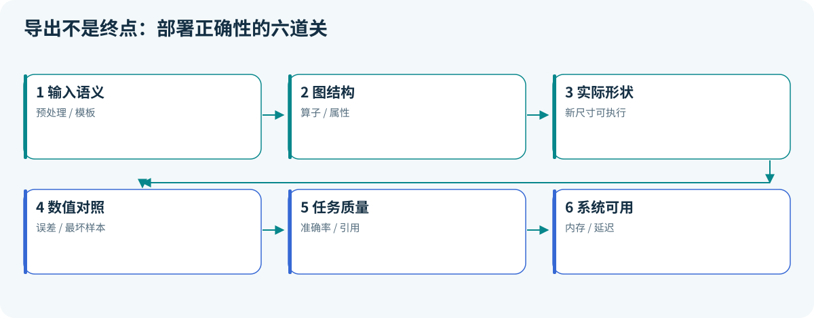

# 03 · 模型交付：导出成功只是第一道门

> 状态：已展开。目标：把训练模型导出为 ONNX，逐层验证语义。前置：第 02 课与 PyTorch 环境。

## 本课结论

一个可交付模型包含结构、参数、预处理、输入输出约定和版本信息。本项目直接把标准化操作注册进导出模型，减少“训练时减均值、服务时忘记减”的风险。



## 先分清四种东西

| 角色 | 示例 | 负责什么 |
|---|---|---|
| 训练框架 | PyTorch | 建模、求导、优化 |
| 表示/文件格式 | ONNX、GGUF | 保存计算或张量及相关元数据 |
| Runtime | ONNX Runtime、llama.cpp | 加载、调度、执行 |
| 编译器/转换工具 | TVM、RKNN Toolkit | 改写、降低表示并适配后端 |

格式名不保证所有模型架构、算子和后端都受支持。后端执行成功，也不能证明预处理或标签顺序正确。

## 六道验证关卡

1. **输入语义**：特征顺序、图像通道、归一化、tokenizer 是否一致。
2. **结构合法**：图和算子属性是否满足格式要求。
3. **形状可执行**：实际支持哪些 batch 和序列长度。
4. **数值一致**：对同一输入比较中间张量或最终 logits。
5. **任务一致**：比较分类结果、准确率、召回率或生成质量。
6. **运行可用**：冷启动、内存、吞吐、异常和稳定性是否满足目标。

数值对照使用：

```math
|a-b|\le \mathrm{atol}+\mathrm{rtol}|b|.
```


当 $`b`$ 接近零，相对误差会夸大；所以应同时报告绝对误差。分类 argmax 相同也不代表 logits 一致：概率分布可能已经变形。反过来，接近决策边界的样本可能因极小数值误差而翻转，应查看其 margin，而不是只报一致率。

## 本项目如何走通

```powershell
python -m pip install -r requirements-export.txt
python -m edge_ai_labs --lab classifier --seed 42
python -m edge_ai_labs --lab export --seed 42
```

阅读 `torch_labs.py::export`：读取 `classifier.pt` → `Pipeline.forward` 完成标准化与预测 → `torch.onnx.export` → `onnx.checker` → ORT CPU session → 对比四种 batch 的 logits → 用封存测试样本评价 ORT 输出。对照容差是 `atol=1e-5, rtol=1e-4`；它是本例 FP32 小网络的验收设置，不是所有模型的统一标准。

导出使用 `dynamo=True`、opset 18 和 `torch.export.Dim`，样例 batch 为 4，检查 batch 为 1、7、32、64。这跟只用导出样例重跑一遍不同。动态 shape 声明也不是“任意大小都能跑”的承诺，仍受图中约束、算子实现与 Runtime 影响。新版 exporter 的签名和约束以 [PyTorch 官方 ONNX 文档](https://docs.pytorch.org/docs/stable/onnx_export.html) 为准。

本实验标准化使用 `register_buffer` 保存均值和标准差，意味着它们随模型一起导出，却不作为可训练参数更新。模型输入始终是原始四维特征，避免导出模型和 HTTP 模型各自要求不同输入。

## 常见失败如何定位

| 现象 | 最先核查 | 接下来做什么 |
|---|---|---|
| 导出提示算子不支持 | exporter、opset、该算子语义 | 缩成最小图，查询后端支持 |
| 只有 batch=4 能跑 | 动态维度是否真正进入图 | 检查 ORT 输入元信息并运行新尺寸 |
| 全部类别反了 | 标签映射、输出轴、特征顺序 | 保存少量 golden 输入输出 |
| 误差只在少数输入出现 | 极值、边界样本、精度 | 逐层比较并记录最坏样本 |
| 速度没有改善 | 线程、图大小、硬件、分配开销 | 做同口径基准，别只看格式 |

ONNX Runtime 的图优化和执行后端说明见 [官方文档](https://onnxruntime.ai/docs/)。第三方软件的检查器只能证明其负责的那一层，不能替你完成全部模型验收。

过关任务：解释为什么代码已经执行 `check_model`，还必须运行不同 batch 并比较 logits。把故意去掉标准化当作一个失败注入实验，说明会在哪一关被发现。本课到跨 Runtime 一致性结束，硬件转换在第 12 课继续。

<!-- COURSE-NAV -->

---

[路线总览](roadmap.md) · [课程与源码](../tutorial.md) · [配套练习](../practice.md) · [上一课 02](02-neural-networks.md) · [下一课 04](04-transformer.md)
