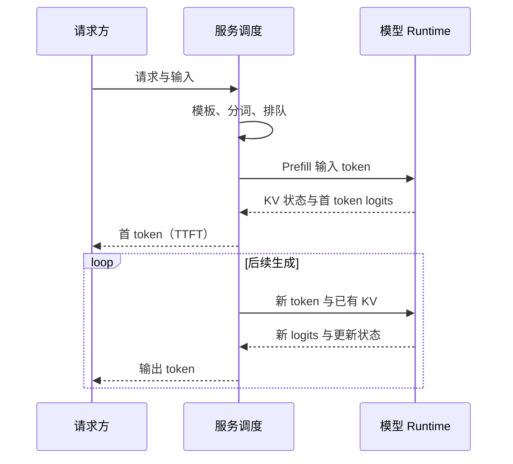

# 05 · LLM 推理：用时间线和内存账理解快慢

> 状态：已展开。目标：区分 prefill、decode、KV Cache 和完整服务延迟。前置：第 04 课。

## 本课结论

Prefill 处理已有输入，decode 利用已有状态继续生成。KV Cache 用更多内存换取减少重复计算；它没有消除新 token 对历史信息的读取。优化必须先知道时间花在哪里。

## 从请求到最后一个 token



给定 100 个输入 token，prefill 可以一次处理这些已知位置；第 101 个 token 被选出后，才能据此生成第 102 个。模型前向输出的是词表 logits，解码策略再选择 token。温度调整分布，top-k/top-p 约束候选；这些方法不等于提高事实准确率。

## KV Cache 为什么正确

在严格因果、推理状态固定的模型中，未来 token 不改变历史位置的隐状态，所以历史层的 K/V 可以保留。对当前位置 $`t`$：

```math
o_t=\mathrm{softmax}\left(\frac{q_tK_{1:t}^\top}{\sqrt{d_h}}\right)V_{1:t}.
```


只算 $`q_t,k_t,v_t`$，把 $`k_t,v_t`$ 追加到缓存，再读取历史 KV。位置编码必须使用全局位置 $`t`$；如果每次 decode 都把 position 重置为 0，shape 虽正确，结果却错误。本项目 `TinyLM.forward` 从缓存长度得到 `offset`，并用全局 query/key 位置构造 mask。

大白话：已经整理好的旧资料不用重新抄一遍，但回答新问题时仍得翻阅相关旧资料。缓存不是让旧资料从内存读取里消失。

## 从缓存 shape 推导内存

标准全注意力各层 KV：$`[B,H_{kv},T,d_h]`$，K 和 V 各一份，每元素 $`s`$ 字节：

```math
M_{KV}=2BTH_{kv}d_hLs.
```


更一般地应逐层求和：

```math
M_{KV}=2Bs\sum_{\ell\in\mathcal A}T_\ell H_{kv,\ell}d_{h,\ell}.
```


$`\mathcal A`$ 是实际缓存历史 K/V 的层。滑动窗口可能让 $`T_\ell`$ 不同；混合注意力层的递推状态应单列；量化 cache 还要加入 scale 等元数据。不能把所有模型统一套进同一个全层公式。

教学配置 $`B=1,T=2048,L=24,H_{kv}=4,d_h=64,s=2`$：

```math
M=50{,}331{,}648\text{ bytes}=48\text{ MiB}.
```


若仅有 6 层全注意力，这部分是 12 MiB，但还没算其他层状态。**本例是合成配置，不是 Qwen3.5-2B 的配置**；真实混合模型见第 17 课。


## 为什么 prefill 与 decode 的瓶颈常不同

线性层 $`[B T,K]@[K,N]`$ 在 prefill 有更多行可复用同一权重；单序列 decode 常接近一行乘大矩阵。粗略 Roofline：

```math
P\le\min(P_{peak},BW\cdot I),\quad I=F/Q.
```


$`F`$ 是 FLOPs，$`Q`$ 是相应存储层级的数据流量。低 batch decode 常受带宽约束，但不能一概而论：batch、上下文长度、量化内核、缓存命中和硬件都会改变主瓶颈。[Williams、Waterman、Patterson，2009，CACM；作者技术报告 PDF](https://www2.eecs.berkeley.edu/Pubs/TechRpts/2008/EECS-2008-134.pdf)

```math
M_{peak}\approx M_{weights}+M_{KV/state}+M_{workspace}+M_{runtime}+M_{I/O}.
```


权重文件只有这些项中的一部分。mmap 文件大小、虚拟地址空间、RSS、NPU 共享缓冲也有不同口径，不能直接相加而不查是否重复记账。

## 指标定义先固定

TTFT 从请求提交到首个输出 token；相邻输出 token 间隔为 ITL；单请求 $`N\gt 1`$ 个输出 token 的平均 TPOT 可定义为 $`(t_N-t_1)/(N-1)`$。端到端延迟是请求到最后输出。服务吞吐是测量窗口内完成的输出 token 数除以时间。预填充速度、单请求生成速度和全服务吞吐分别报告。

## 实验与过关任务

运行 `python -m edge_ai_labs --lab memory`，阅读 `math_labs.py::kv_bytes` 的逐层求和；运行 `--lab tiny-lm` 检查真实缓存对照。`memory` 返回理论 payload，不尝试冒充 RSS 测量。

请预测：上下文翻倍、batch 翻倍、KV 头减半分别如何改变该公式？再解释为什么实际峰值内存不一定精确按这个比例变化。全注意力缓存思想可延伸阅读 [Shazeer，2019，Fast Transformer Decoding](https://arxiv.org/pdf/1911.02150)。

<!-- COURSE-NAV -->

---

[路线总览](roadmap.md) · [课程与源码](../tutorial.md) · [配套练习](../practice.md) · [上一课 04](04-transformer.md) · [下一课 06](06-quantization.md)
