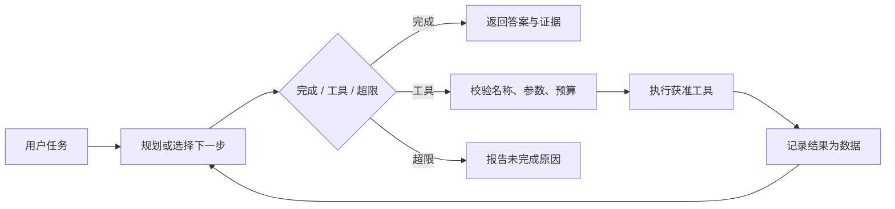

# 07 · RAG 与 Agent：知识从哪里来，动作由谁执行

> 状态：已展开。目标：区分检索、生成、决策和工具执行。前置：第 04 课概念；本课代码只需 NumPy。

## 本课结论

RAG 把外部证据放进生成过程；Agent 把模型的建议接到可执行动作。两者都需要独立评估。一个能返回文档的检索器不等于完整 RAG，一个规则路由器也不能冒称会自主规划的 Agent。

## RAG 的两条链

离线链：文档 → 清洗 → 切块 → 表示 → 索引。在线链：问题 → 检索 → 可选重排 → 证据上下文 → 生成 → 引用核对。大白话：先给书做索引，再让回答者带着找到的页码回答；找到了错误页码，回答者再聪明也容易答错。[Lewis 等，2020，NeurIPS，PDF](https://arxiv.org/pdf/2005.11401)

分块太小可能丢失条件，太大可能把噪声与有效句子一起送入上下文。重叠能缓解边界截断，也会造成重复证据。文档更新时需要更新索引并保留版本，否则“检索到了”仍可能是过时知识。

本实验用中英文词项和中文双字片段构建简单 TF-IDF：

$$\operatorname{idf}(t)=\log\frac{1+N}{1+df(t)}+1,\quad
v_{d,t}=tf(t,d)\operatorname{idf}(t),\quad
\operatorname{score}(q,d)=\frac{v_q^\top v_d}{\|v_q\|\|v_d\|}.$$

这是词项匹配基线，不是语义 embedding。中文分词也只做了教学简化。优点是无需网络或模型即可检查全部权重；缺点是同义改写、跨语言和长距离语义很弱。

## 分开评估，才能知道错在哪里

| 层 | 指标/问题 | 如何构造失败样本 |
|---|---|---|
| 检索 | Recall@k、MRR | 用同义问法、罕见实体、无关问题 |
| 重排 | 正确证据是否前移 | 混入词相似但结论相反的文档 |
| 生成 | 回答正确、引用支持、证据忠实 | 提供含条件与例外的段落 |
| 系统 | 超时、成本、索引新鲜度 | 删除文档、更新内容、故障注入 |

本项目只有 4 道固定玩具检索题，Recall@2=1 只说明这四题命中了预设文档；题目覆盖太小，不能外推真实准确率。`retrieve` 对没有词项交集的问题返回空结果，便于演示拒答。正式系统需要根据独立开发集选择阈值，不能把任意大于 0 的词项相似度当作“证据充分”。

## Agent 的状态机与权限边界



ReAct 讨论推理与行动的交替组织，并不意味着应用可以不加约束地执行文本中的命令。[Yao 等，2023，ICLR，PDF](https://arxiv.org/pdf/2210.03629)

工具输出、网页和检索文档都属于数据。工具名与参数需要校验；对写操作的权限、预算和超时由应用控制。MCP 规范描述连接和消息等协议机制，不能自动保证业务授权正确；使用时固定规范版本。[MCP 官方规范，2025-06-18](https://modelcontextprotocol.io/specification/2025-06-18)

## 实验、源码和升级路线

```powershell
python -m edge_ai_labs --lab rag
```

`systems.py::rag` → `retrieve` 构建只基于文档的词表/IDF → 返回带文档 ID、文本和分数的证据 → 对四题统计命中。随后 `call_tool` 只允许 `get_model_info`，拒绝额外参数、未知模型和超出 3 次的预算。

输出包含摘录与确定性工具结果，没有调用 LLM，也没有实现多轮自主规划。要升级为完整 RAG，先接入第 08 课的本地生成端点，把文档 ID 放进 prompt，再人工核对答案与引用；要升级为 Agent，给状态机增加明确的模型选择、超时、取消和轨迹记录。

过关任务：构造一个词面几乎相同、结论相反的文档，使检索命中却不能据此直接回答；说明还需要哪层检查。暂缓真实写工具和多智能体编排，本课关注可核查的数据流。

<!-- COURSE-NAV -->

---

[路线总览](roadmap.md) · [课程与源码](../tutorial.md) · [配套练习](../practice.md) · [上一课 06](06-quantization.md) · [下一课 08](08-llama-cpp.md)
