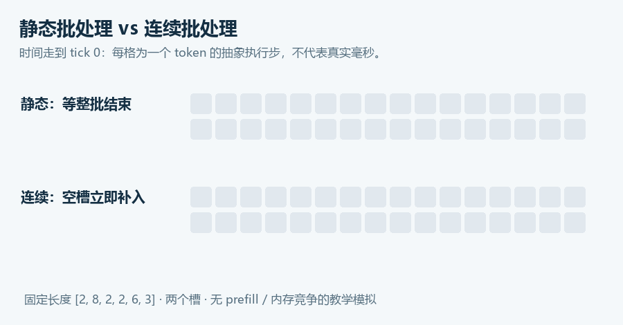

# 09 · Serving：从“能生成”到“多人同时用”

> 状态：已展开。目标：理解连续批处理、分页 KV、Runtime 选型与公平对比。前置：第 05 课。

## 本课结论

Serving 的核心是协调请求与有限资源。高吞吐、低 TTFT、低尾延迟可能互相牵制。vLLM、MLC-LLM 和 llama.cpp 的定位不同，不能仅按单一 tokens/s 排名。

## 连续批处理为什么有用

有两个执行槽，A 生成 2 token，B 生成 8 token。静态批处理可能等待整批 B 完成再接 C；连续批处理在 A 完成后让 C 进入，减少空槽。大白话：一桌人都吃完才换下一桌，和哪个座位空了就补人，利用率当然不同；但补人、端菜和排队本身也有成本。



`systems.py::simulate` 假设所有请求在 tick 0 到达，每个活跃序列每 tick 输出一个 token。它没有 prefill、带宽竞争、KV 容量、优先级或抢占，目的是让调度时间线可以逐格检查。默认长度 `[2,8,2,2,6,3]`：静态 16 tick，连续 12 tick；这是模型假设下的结果，不是 vLLM 实测提速。

```powershell
python -m edge_ai_labs --lab serving
```

先读 `serving` 的长度与槽数，再读 `simulate`：补入请求 → 保存本轮成员 → 产生 token → 记录完成 → 移除完成请求。测试检查每个请求恰好产生指定数量 token，且活跃数不超过槽数。

## PagedAttention 和 FlashAttention 解决不同问题

KV 长度动态增长，若为每请求预留最大连续空间，会浪费容量。分页把逻辑连续 token 映射到物理块，减少碎片并支持共享。它不改变每个 KV 元素的位宽，也不是把标准注意力算术复杂度自动变成线性。[Kwon 等，2023，SOSP，PDF](https://arxiv.org/pdf/2309.06180)

FlashAttention 主要优化注意力计算的数据流；分页 KV 主要改变缓存存放与访问组织。具体实现可组合两类思想。Prefix caching 可复用相同前缀已算出的状态，直接节约的是重复 prefill；缓存还占资源，所以系统吞吐与尾延迟的最终变化要测。

## Runtime 如何选择

| 路线 | 优先研究的问题 | 不能直接假定的事 |
|---|---|---|
| llama.cpp | 本地/嵌入式推理、GGUF、CPU 与多后端 | 有 NPU 就自动加速 |
| vLLM | 高并发调度、KV 管理、服务指标 | 当前环境一定支持目标设备/模型 |
| MLC-LLM | 编译驱动、多目标部署与模型库 | 所有设备都无需重新编译/配置 |
| RKLLM | 厂商支持矩阵内的 NPU LLM 部署 | GGUF 可以直接当 `.rkllm` |

vLLM 与 MLC 的安装、设备和模型支持随版本变化，先读 [vLLM 官方文档](https://docs.vllm.ai/) 和 [MLC Python Engine 文档](https://llm.mlc.ai/docs/deploy/python_engine.html)。本仓库没有把它们塞进基础依赖，也未完成其硬件实测。

vLLM 的可选启动模板如下，要求在**已按官方要求安装且硬件受支持**的独立环境中执行，并把 `models/hf-model` 替换为已下载和核验的模型目录：

```bash
python -m pip show vllm
vllm serve --help
vllm serve ./models/hf-model --host 127.0.0.1 --port 8081
```

先用单请求验证 template、输出与内存，再逐步提高并发。MLC 路线先确认目标架构、权重转换产物和模型库匹配，再通过 `MLCEngine` 运行。命令/API 以所固定版本为准，不提供一个貌似通用却缺目标配置的编译命令。

## 公平比较需要同一到达过程

闭环压测是“收到响应再发下一个”，适合测固定并发，但服务一变慢，客户端也少发请求；开环按设定到达率发请求，更能观察过载排队。比较时固定请求集合、到达种子、输入/输出 token 长度、超时与错误口径。

Little 定律 $N=\lambda W$ 在稳定系统、统一边界和长期平均下关联在系统请求数、吞吐和逗留时间；不能拿瞬时值套它预测任何队列。平均吞吐提高也可能伴随 p95 TTFT 变差。

过关任务：在调度模拟中加入不同到达时刻与一个 KV token 预算，说明“空槽存在但不能接新请求”的条件。把新模型假设写到报告开头，再讨论结果。真正服务压测方案在第 15 课继续。

<!-- COURSE-NAV -->

---

[路线总览](roadmap.md) · [课程与源码](../tutorial.md) · [配套练习](../practice.md) · [上一课 08](08-llama-cpp.md) · [下一课 10](10-compiler.md)
