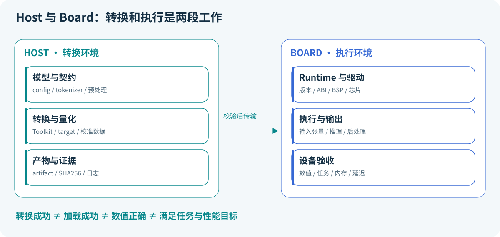

# 12 · RKNN 与 NPU：把兼容性当作完整链路检查

> 状态：已展开；硬件流程待读者实测。目标：理解 Host 转换、Board 执行和精度验证。前置：第 03、06 课；需要 SDK 支持的 Host 和 Rockchip 板卡才能执行本章硬件部分。

## 本课结论

NPU 部署不是给 ONNX 换一个后缀。模型算子、shape、量化参数、转换器、产物、Runtime、驱动和目标芯片需要共同兼容。先做最小模型的浮点/高精度基线，再研究量化与吞吐。

## Host 与 Board 分工



Host 负责转换、量化和产生 `.rknn`；Board 负责以 Runtime 与驱动执行。Python wheel、ARM 动态库、内核驱动不是同一个组件；仅更新其中一个未必解决兼容问题。

官方入口：[RKNN-Toolkit2](https://github.com/airockchip/rknn-toolkit2)、[RKNN Model Zoo](https://github.com/airockchip/rknn_model_zoo)。模型、芯片、算子和 wheel/系统支持以所选 release 的文档为准。本章不以在线最新版本自动替换你已经验证的版本矩阵。

## 从本仓库的小模型开始

第 03 课导出的是动态 batch ONNX；第一轮 NPU 实验宜另做静态 batch=1，减少变量：

```powershell
python -m edge_ai_labs --lab classifier
python adapters/export_static.py
```

`export_static.py` 的主机端导出已在本交付环境测试；它不证明 NPU 编译器支持全部算子或 opset。本例标准化已在图内，不要在 RKNN config 再重复同一组 mean/std。

在**独立、由官方 SDK 支持的转换环境**准备对应 Toolkit 后，才运行以下适配模板：

```bash
python adapters/convert_rknn.py --model artifacts/classifier-static.onnx --target rk3576 --output artifacts/classifier.rknn
```

模板按 `config → load_onnx → build → export_rknn → release` 组织，检查每一步返回码，保存输入/产物 SHA256。该模板未在本交付运行 RKNN；若 SDK 不支持此 ONNX，需要按其支持矩阵调整导出或算子，而不是忽略错误。需要量化时才增加 `--dataset calibration-list.txt`，格式严格遵循你固定版本的 SDK 示例。

校准数据应与原始模型输入一致，保持正确 shape、dtype、范围。图中已含标准化，校准时输入就应是原始特征，不能先标准化两次。完成转换仍需使用官方 Runtime 示例做板端推理，保存 raw outputs 与同一输入的 PyTorch/ORT 输出对照。

## NCHW、NHWC 与预处理

图像链路要逐项固定：相机/文件输入 → 色彩空间 → 裁剪/letterbox → resize → 归一化 → layout → dtype → 推理 → 后处理。NCHW 是 $`[B,C,H,W]`$，NHWC 是 $`[B,H,W,C]`$；交换 shape 不能代替正确地转置数据。

假如训练用 RGB，而摄像头给 BGR，模型往往还能输出“像真的”类别，但整体质量变差。把一张有红、绿、蓝三色块的测试图跑过完整预处理，直接检查输入张量，比盲目调阈值有效。

所谓零拷贝也要说明哪段链路共享缓冲、谁拥有内存、同步在哪里完成。减少一次 memcpy 不等于整个端到端链路没有任何转换或缓存操作。

## 三层精度与性能检查

| 层次 | 必须保存的证据 |
|---|---|
| 原始模型 vs 转换工具结果 | 同一 golden 输入、输出 shape、误差 |
| 转换工具 vs Board Runtime | 同一产物、输入、输出、版本与日志 |
| 真实输入到业务输出 | 预处理、后处理、任务指标和失败样例 |

先确认正确性，再测单模型推理，最后加入采集、拷贝、排队和可视化。宣传中的峰值 TOPS 对应特定位宽与条件，不能直接换算成某个模型 FPS。

## 排错顺序和过关任务

Host 导入失败先查 wheel/Python/架构；编译失败查算子/opset/shape；加载失败查产物与 Runtime/驱动/芯片；输出错误查预处理/布局/量化；慢则查数据路径、CPU fallback 和真实设备利用。保存最小失败样本，避免只贴一行报错。

过关标准是用同一输入证明 PyTorch、ORT 与 Board 输出之间的关系，并提交版本矩阵。未持有板卡时，完成主机端导出和验证即可，硬件状态写“待验证”，不能填模拟出的板端延迟。

<!-- COURSE-NAV -->

---

[路线总览](roadmap.md) · [课程与源码](../tutorial.md) · [配套练习](../practice.md) · [上一课 11](11-kernel-and-flashattention.md) · [下一课 13](13-rkllm.md)
