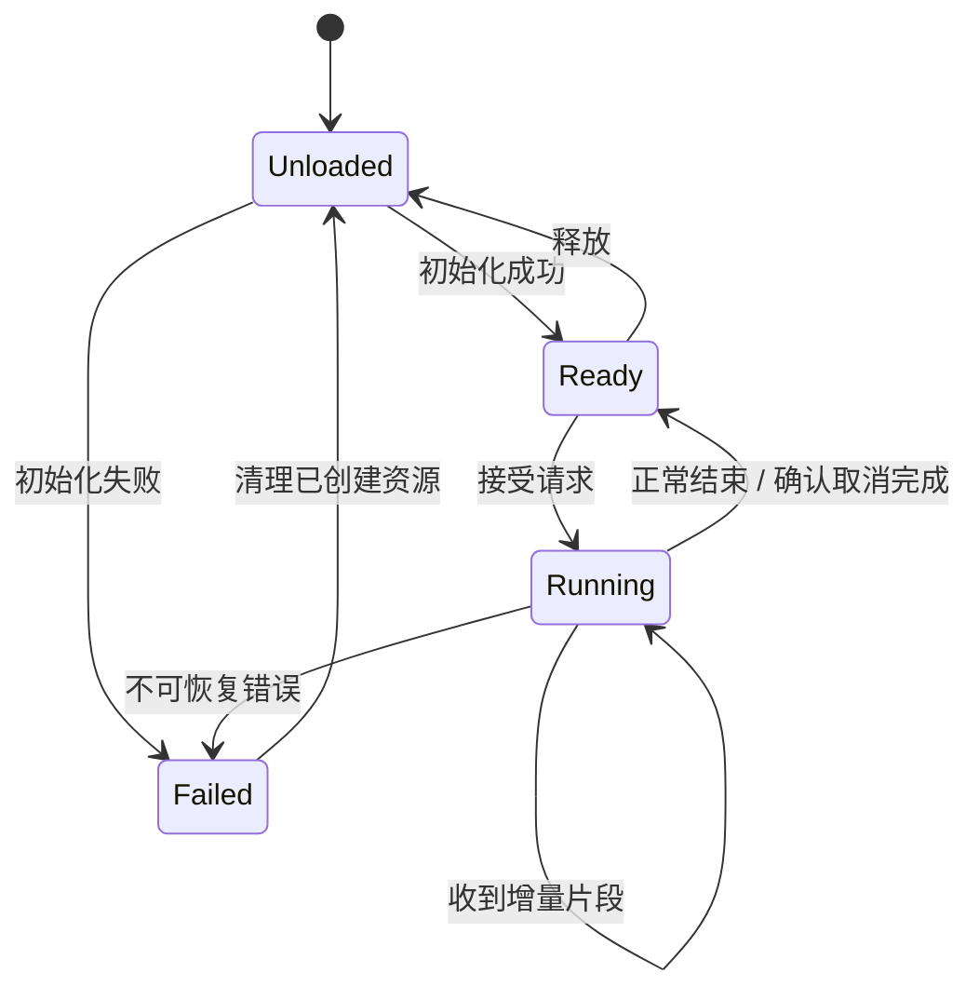

# 13 · RKLLM：语言模型的产物、状态与生命周期

> 状态：已展开；硬件部分待实测。目标：设计可复现的厂商 LLM 部署流程。前置：第 05–06、12 课。

## 本课结论

RKLLM 的学习重点是支持矩阵、产物转换、Runtime 状态和资源生命周期。厂商算法缩写不能凭名字还原成论文算法；没有官方证据，就只描述可观察的接口与结果。

## 和 RKNN、GGUF 的关系

`.rknn` 与 `.rkllm` 不是同一种部署产物，GGUF 也不能直接改后缀转换。SDK 的模型结构支持、量化方式、目标平台和运行库之间需要匹配。[Rockchip 官方 rknn-llm 仓库](https://github.com/airockchip/rknn-llm)

选模先查官方支持矩阵，再查具体模型 revision/config。本教程以 Qwen3.5-2B 作为进阶配置解剖案例；实际部署从当前 SDK 明确支持、能验证正确性的小模型开始，并单独记录测量结果。

## 转换前先写清交付契约

| 项目 | 要记录的内容 |
|---|---|
| 模型 | ID、revision、config、tokenizer/template hash |
| Host | OS、CPU 架构、Python、Toolkit 版本 |
| 转换 | target、量化类型、算法配置、校准数据 hash |
| 产物 | 路径、大小、SHA256、转换日志 |
| Board | SoC、RAM、BSP/kernel、driver、Runtime |
| 任务 | prompt、上下文上限、输出上限、采样和停词 |

不要把 `.rkllm` 大小当作运行内存，也不要把 W4A16 理解成所有缓存与累加都用 4/16 bit。GRQ 等选项应按固定 SDK 版本的官方说明理解；本教程不猜测其内部 group size、损失函数或层敏感性策略。

## 一次推理的资源主链

这是一种建议的应用层状态机，**不是对某个 SDK 内部状态的断言**。具体 C API、同步/异步、取消方式与回调枚举必须查看该 release 的头文件与例子。不能假定销毁函数可在任意回调线程安全调用。

大白话：权重像图书馆的藏书，会话缓存像某位读者的借阅桌。多次访问可以共享藏书，但不能随意混用不同读者的桌面笔记。资源归属不清，会话串扰、释放时机和内存增长就很难排查。

## 建议的运行封装

初始化完成后再接受请求；每个请求拥有 ID、时间戳、取消标记和输出缓冲。回调只做轻量数据转交，UI/网络线程负责展示。根据 SDK 实际线程安全契约选择单 worker 或多实例，不因 HTTP 服务支持多线程就同时操作同一模型句柄。

结束、失败、超时、客户端断开是不同事件。客户端断开并不自动终止底层生成；取消发出也不等于资源已经空闲。状态转换应在确认运行结束后完成。需要限制输入长度、输出长度和会话数量，避免内存预算只有平均值没有峰值。

## 分三阶段落地，避免同时排十个错误

1. **官方基线**：使用固定 release 自带、明确支持目标芯片的模型/例子，保存日志。
2. **自有产物**：只替换模型转换结果，维持其它条件，检查模板、EOS、输出与内存。
3. **服务集成**：再加入会话、流式输出、超时、取消和 UI，每次只增加一种复杂性。

本交付不附一个凭猜测拼出的通用 RKLLM Python/C API 实现。官方导出参数与回调签名变化快，应把固定 release 的官方示例作为可执行起点，再按上面的应用契约包裹。模板和记录表位于 `templates/`。

## 混合注意力与多模态的额外约束

标准 KV 公式只能用于真实全注意力层。线性注意力的递推状态、短卷积缓存、精度与分配策略另算，见第 17 课。图像问答还需要匹配的视觉 encoder、projector、特殊 token 与图像预处理。把任意图像 embedding 送进任意语言模型并不是通用多模态接口。

过关任务：画出“初始化失败”“正常结束”“用户取消”三条路径，标出每份资源何时获得、何时确认释放。没有板卡时提交状态设计与版本计划；不要标成已完成运行验证。

<!-- COURSE-NAV -->

---

[路线总览](roadmap.md) · [课程与源码](../tutorial.md) · [配套练习](../practice.md) · [上一课 12](12-rknn.md) · [下一课 14](14-linux-and-integration.md)
