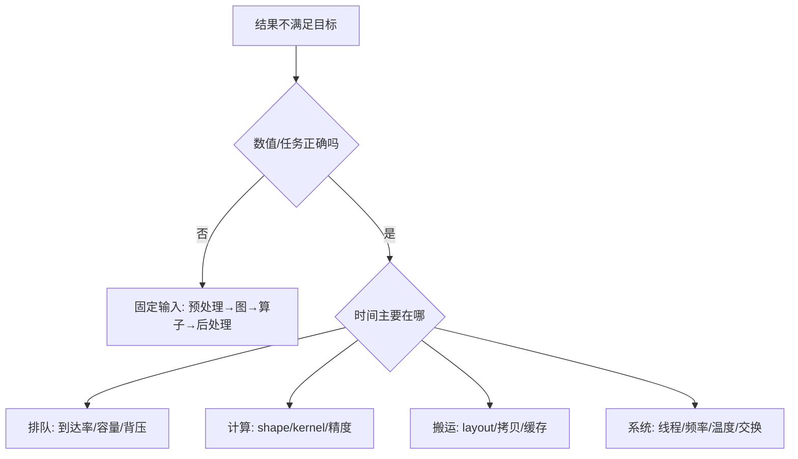

# 15 · 基准与排错：用证据决定优化方向

> 状态：已展开。目标：建立数值、任务、性能和稳定性分层报告。前置：第 03、05、14 课。

## 本课结论

一次优化只有在相同任务、质量约束和测量边界下比较，才有意义。先记录原始数据，再写结论。工具跑完没有报错，只是最低要求。

## 第一步：定义你究竟测哪一段

$$T_{e2e}=T_{queue}+T_{preprocess}+T_{transfer}+T_{compute}+T_{postprocess}+T_{transport}.$$

这是划分思路，各项若实际重叠，不能把独立计时直接相加当墙钟时间。需要区分端到端耗时、设备事件耗时与各阶段重叠。异步设备若只计提交 API 的时间，会把主要计算漏掉；应使用该设备支持的同步/事件方法。

本仓库 `scripts/benchmark.py` 只测 CPU 进程内“预处理 + forward”，输入张量已分配；不包含请求队列、HTTP 和序列化。它设置单线程、30 次预热、300 次采样，保留原始毫秒数组，分别测试 batch=1/8/32/64。

```powershell
python -m edge_ai_labs --lab classifier
python scripts/benchmark.py --repeats 300
```

输出是很小 MLP 的微基准，不应拿其高 samples/s 推断真实网络服务容量。计时开销、操作系统调度和后台进程在微秒级结果中占比可能很高。跨设备比较先扩大足够代表实际任务的工作负载。

## 第二步：选择统计口径

均值反映总时间摊到请求的平均，p50 反映典型请求，p95/p99 反映尾部。300 样本可以初步看分布，不能为高精度尾延迟保证提供充分证据。长任务要重复独立运行，明确实验单位；同一次运行里的许多 token 不是许多独立实验。

吞吐用“完成工作量 / 墙钟窗口”计算。batch latency、每样本平均摊销时间和单样本独立请求时延不同：一次 batch=64 用时 1 ms，不代表单个独立请求只要 $1/64$ ms。

冷启动包括首次加载、编译、页缺失和缓存建立等；稳态测试另做。温度/频率、功耗模式和是否启用 swap 需要记录，尤其是小板卡。不要把最冷的一次结果与另一配置的热稳态结果对比。

## 第三步：给 LLM 固定工作负载矩阵

| 因素 | 建议起点 | 必须说明的边界 |
|---|---|---|
| prompt 长度 | 128、512、2048 token | 以实际 tokenizer 计数 |
| 输出长度 | 固定上限并记录实际输出数 | EOS 提前停止会影响工作量 |
| 并发 | 1、2、4，逐级增加 | 队列与内存是否过载 |
| 精度 | 高精度基线、一个量化候选 | 任务质量先过门槛 |
| 重复 | 独立多次运行 | 缓存、模板、随机种子一致 |
| 内存 | 初始化、prefill 峰值、decode、结束后 | RSS/PSS/设备内存口径 |

分别报告 TTFT、ITL/TPOT、端到端延迟、完成吞吐、超时率和错误率。prefix cache、prompt cache、权重 page cache 要明确命中条件，不能把缓存命中与不命中混成同一配置。

## 第四步：用 Amdahl 定律判断值不值得做

若目标部分占原始时间比例 $f$，该部分加速 $s$ 倍，总加速比为：

$$S=\frac1{(1-f)+f/s}.$$

假如模型计算只占总延迟 40%，即便无限加速，整体上限也只有 $1/0.6\approx1.67$ 倍。大白话：一小时的流程里只有 24 分钟在算模型，把这段全省掉仍要花 36 分钟。先测时间占比，能避免在不重要的 Kernel 上耗费大量时间。

## 排错树



建议实验记录和版本矩阵见 `templates/`。过关任务：给“量化后慢了 10%”写一个排查计划，先列三个能区分原因的测量，再提出优化；不要从结论倒推一个没有日志支持的解释。

<!-- COURSE-NAV -->

---

[路线总览](roadmap.md) · [课程与源码](../tutorial.md) · [配套练习](../practice.md) · [上一课 14](14-linux-and-integration.md) · [下一课 16](16-capstone.md)
