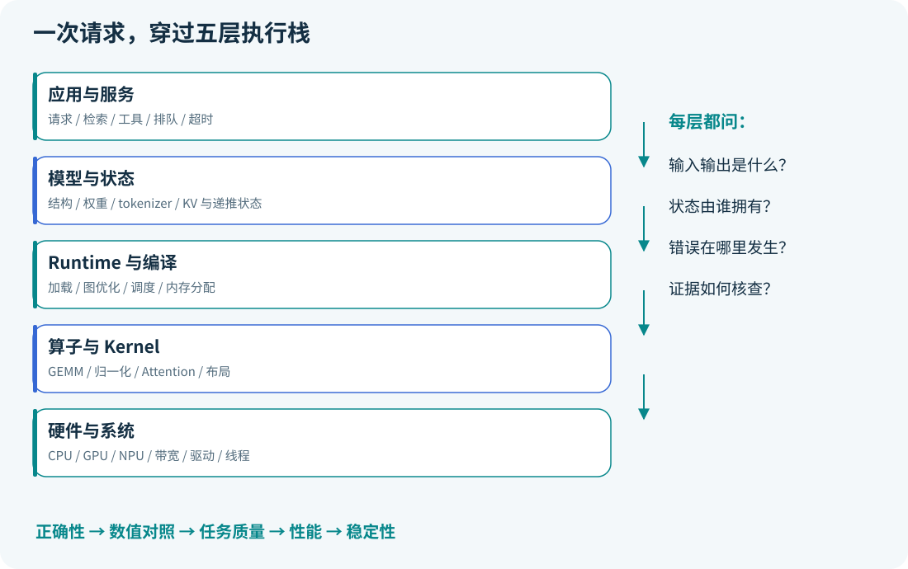

# 知识体系：模型、执行和系统的三条线

本项目用三条线组织知识：模型线解释“算什么”，执行线解释“怎样算”，系统线解释“如何持续服务”。三条线通过正确性、内存和测量互相约束。

| 层次 | 必备概念 | 能回答的问题 | 课程 |
|---|---|---|---|
| 数学与数据 | 矩阵、梯度、概率、划分、分布 | 结果是否来自泄漏？ | 00–02 |
| 模型 | MLP、CNN/RNN、attention、tokenizer、位置 | 每个输出依赖哪些输入？ | 02、04 |
| 训练与交付 | 优化、选模、checkpoint、ONNX、容差 | 转换后语义是否保留？ | 01–03 |
| 推理状态 | prefill/decode、KV、递推状态、采样 | 为什么慢、为什么占内存？ | 05、17 |
| 低位宽 | scale/zero point、校准、PTQ/QAT、分组 | 哪些误差值得、哪些 Kernel 支持？ | 06 |
| 应用 | 检索、证据、工具、状态机、预算 | 知识/动作来源是否可追溯？ | 07 |
| Runtime/Serving | batch、分页、共享、排队、后端 | 多请求如何利用有限资源？ | 08–09 |
| 编译与 Kernel | IR、融合、布局、分块、在线归一化 | 如何减少搬运并保持正确？ | 10–11 |
| 芯片部署 | Toolkit、artifact、Runtime、driver | 哪个环节不兼容？ | 12–13 |
| 系统与验证 | Linux、线程、HTTP、测量、稳定性 | 如何让别人复现与定位失败？ | 14–16 |

## 一次请求贯穿全栈

请求文本不是张量；tokenizer/template 先决定模型真正收到什么。Runtime 管理权重与状态；编译器和 Kernel 决定目标设备如何执行；服务层决定何时接入、取消、结束。输出正确也需要 tokenizer 解码、后处理与引用解释正确。

## 最容易串错的五对概念

| 概念 | 正确边界 |
|---|---|
| 参数量 / FLOPs | 前者描述存储规模的一部分，后者依输入 shape 与运算定义 |
| FLOPs / FLOP/s / TOPS | 工作量 / 浮点速率 / 以特定位宽等条件计的操作速率 |
| 权重文件 / 峰值内存 | 运行还有 cache、workspace、缓冲和框架开销 |
| 格式 / Runtime / 编译器 | 描述、执行、改写/降低表示；不能互相替换 |
| 数值一致 / 任务质量 / 服务可用 | 三类独立证据，缺一类不能替另一类作保证 |

## 重点公式的“使用条件”

| 公式 | 使用前检查 |
|---|---|
| $`Y=XW^\top+b`$ | 权重存放约定和输入轴一致 |
| $`\mathrm{softmax}(QK^\top/\sqrt d)V`$ | softmax 轴、mask、Q/K 维度 |
| $`M_{KV}=2BTH_{kv}d_hLs`$ | 是否全注意力、实际层数/长度/精度 |
| $`P\le\min(P_{peak},BW\cdot I)`$ | 同一存储层级、单位、工作负载与持续上限 |
| $`q=\mathrm{clip}(\mathrm{round}(x/s)+z)`$ | 范围、zero point、舍入规则、裁剪 |
| $`N=\lambda W`$ | 稳定系统、相同边界、长期平均 |

推导与具体反例见各课；[公式与术语速查](glossary.md) 用于回看，不代替完整学习。版本敏感事实统一从 [资料索引](../references/README.md) 跳转官方来源。
