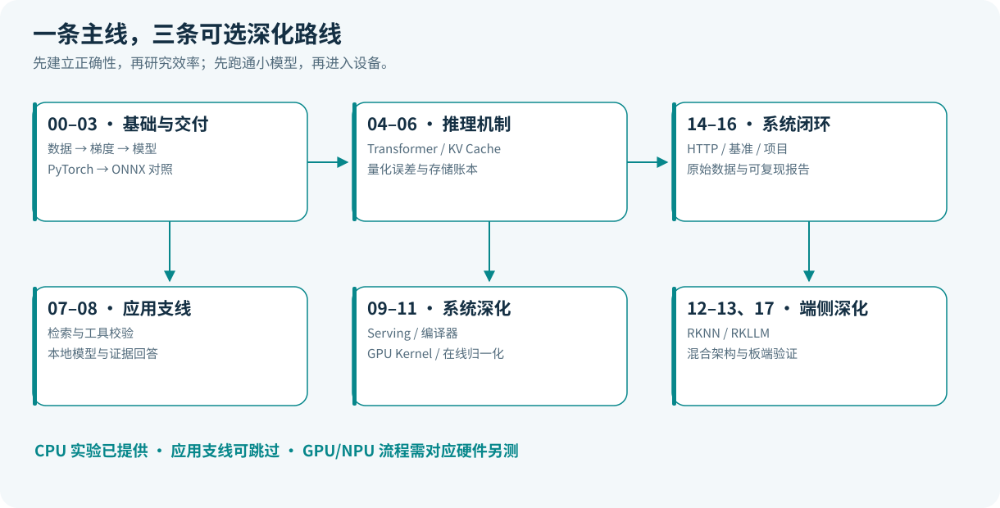
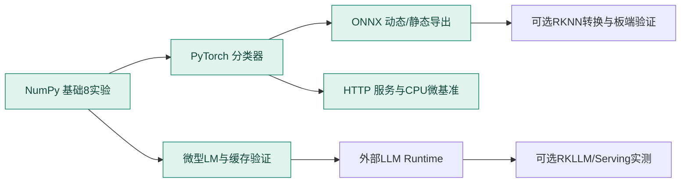

# 从零到端侧：按能力依赖走，而不是按框架数量走

先完成一条可运行闭环，再选择应用、Serving 或硬件方向加深。路线的结束条件是你能解释并复现实验，不是读完页面。

## 三种起点

| 你现在的状态 | 从哪里开始 | 先不做什么 |
|---|---|---|
| Python/矩阵不熟 | 00 → 01 → 02，预留补基础时间 | 先不安装硬件 SDK |
| 会训练，缺部署 | 03 → 05 → 06 → 14 → 15 | 先不同时比较三个 Runtime |
| 已有推理经验 | 05 的数值自检，再选 09–13/17 | 先核查旧经验的版本与假设 |

## 12 周主线（有 Python 基础，每周约 6–8 小时）

以下时间是学习建议，不是完成保证。一次深度硬件排错可能需要额外时间；没有板卡时把硬件周用于理论和主机验证。

| 周 | 内容与问题 | 必须产出的证据 |
|---|---|---|
| 1 | 00–01：如何建立正确评估 | 基础报告、训练/验证/测试划分解释 |
| 2 | 02：梯度与训练四步 | 有限差分对照、114 参数 MLP |
| 3 | 03：导出后的语义是否保留 | 4 种 batch 数值对照和任务结果 |
| 4 | 04：attention 在算什么 | shape 手算、因果检查、微型 LM |
| 5 | 05：缓存为何有效、占多少内存 | logits 等价检查、KV 单位推导 |
| 6 | 06：低位宽有什么代价 | 逐通道/裁剪对照及反例解释 |
| 7 | 07–08：证据如何进入本地应用 | 检索基线；可选 GGUF 官方链路日志 |
| 8 | 09：多人请求如何调度 | token 守恒检查；模拟假设列表 |
| 9 | 10–11：计算和搬运如何组织 | 尾块矩阵乘、在线 softmax 推导 |
| 10 | 12–13：产物与设备如何匹配 | 静态 ONNX；版本矩阵；有板卡再补实测 |
| 11 | 14–15：服务如何可靠测量 | HTTP 测试、原始延迟、指标定义 |
| 12 | 16–17：形成独立项目与理解 | 一份完整复现报告和架构账本 |

## 24 周从零方案

把上表每周拆成两周：第一周学最少前置、推一遍公式并读源码；第二周运行实验、做错例、复述因果链并补报告。前六周至少掌握 Python 模块/环境、矩阵乘法、对数与导数。遇到大段工具安装不要假装在学算法，把安装记录和机制笔记分别保存。

## 三条可选深化路线

**通用部署路线**：00 → 01 → 02 → 03 → 06 → 12 → 14 → 15 → 16。先学小模型交付；LLM 可后补。

**LLM 系统路线**：00 → 02 → 04 → 05 → 06 → 08 → 09 → 10 → 11 → 15 → 17。重点研究计算、内存和调度。07 可选。

**本地应用路线**：00 → 02 → 04 → 05 → 07 → 08 → 14 → 15 → 16。检索、生成与动作分别验收，再组合。

## 源码和实验的依赖

基础 NumPy 实验彼此独立；`export` 若发现权重不存在会先训练，建议初学者仍显式跑一次 `classifier` 观察过程。`serve`、`benchmark.py` 和静态导出要求已有 `classifier.pt`。RKNN/RKLLM 不属于默认依赖。

## 每课都问这六个问题

输入到底是什么？什么状态会改变？公式在哪些假设下成立？同一输入的独立参考结果是什么？失败会留下什么证据？能否不用原文复述因果链？

学习进度可在 [配套练习](../practice.md) 标记；课与课的代码阅读边界见 [源码课程入口](../tutorial.md)。遇到不懂的符号，先从 shape、单位和一个小数值例子切入。
